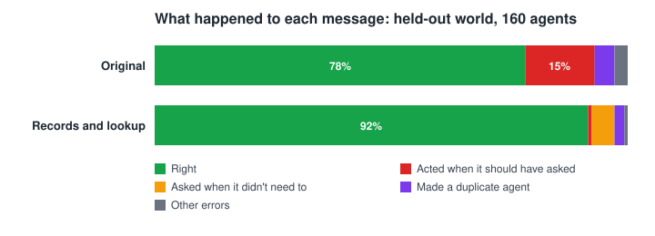
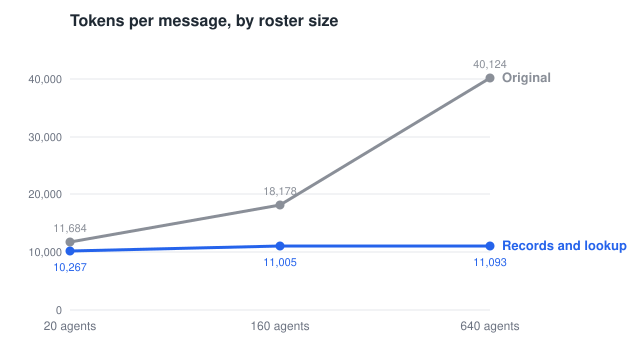

# 08 · Technical Report: Addressing Agent Overload in OpenPoke

OpenPoke routes every user request through a single orchestrator that sees only a flat list of bare agent names and is prompted never to ask clarifying questions. This report presents a deterministic routing benchmark, a seven-variant controlled ablation, and a SQLite work-record retrieval architecture that raises held-out routing accuracy from 78% to 92% while cutting prompt tokens by 73% at 640 agents.

## Executive Summary

### Approach

1. **Benchmark before code:** Built and froze (`cases-frozen`) a deterministic synthetic benchmark of multi-contact email worlds (448 development cases, 158 held-out cases, and a 40-case noisy stress set) graded by deterministic rules across two-turn clarification loops, with zero LLM-as-judge calls.
2. **Controlled ablation:** Implemented seven incremental configurations (`v0`–`v5`, `v2d`) behind environment flags in the shared runtime to isolate prompt rules, candidate shortlisting, structured state, deterministic keyword gates, and a pre-routing LLM classifier.
3. **Chosen architecture (`v2`, Work-Record Shortlist):** Each execution agent maintains a SQLite work record populated deterministically from its tool-call arguments (participant emails, Gmail `thread_id`s and subjects, reminders, and search queries) alongside a contacts table. Before each orchestrator turn, a zero-LLM lookup combines recent handoffs, contact matches, last-shown turn context, and SQLite FTS5 (`BM25`) search to surface at most 10 candidate agents plus matching contacts, constraining dispatch to explicit `agent_id`s and a duplicate-checked `create_agent` tool.

### Headline Results (Held-Out Set, Single Untuned Run)

| Metric (160 Agents Unless Noted) | Work-Record Shortlist (`v2`) | Original Baseline (`v0`) |
|---|---:|---:|
| Overall routing accuracy | **92%** | 78% |
| Clarifies ambiguous requests | **97%** | 42% |
| Unnecessary clarifications on clear requests | **7%** | 0–2% |
| Prompt tokens per message (at 640 agents) | **10,700** | 39,700 |

*All experiments used `anthropic/claude-haiku-5.5` across all roles; total OpenRouter spend was ~$30.*

### Key Findings

- **Silent guessing is the baseline's dominant error.** When a message could reasonably refer to more than one thread or person (such as *"nudge Tessa"* when Tessa has two open threads, or *"send Omar my number"* when two Omars are in the user's contacts), the baseline asks a clarifying question only 33–47% of the time. On the remaining runs it either picks one agent at random or messages every matching agent at once.
- **Structured tool-call records outperform one-line summaries by 11 points on dev.** Shortlisting candidates over a one-line text summary per agent (`v2d`) reaches 86% accuracy, whereas indexing structured records from execution tool calls alongside a contacts table (`v2`) reaches 97%. That gap comes from surfacing contacts who do not have an agent yet, tracking CC'd intermediaries such as insurance adjusters, and preventing duplicate agents for ongoing threads.
- **Catching real ambiguity trades off against mild over-caution on clear messages.** On the held-out benchmark, accuracy on genuinely ambiguous categories rises from 0–58% to 80–100%, while clear requests see a 7% unnecessary-question rate. Unnecessary questions are graded strictly as failures so an "always ask" strategy cannot game the metric.
- **Longer agent lists inflate token cost; multiple threads per contact break accuracy.** Scaling the roster from 10 to 1,280 agents by adding unrelated background contacts leaves Claude Haiku 5.5's accuracy flat at 73–80% while multiplying prompt tokens nearly sixfold. By contrast, keeping the roster at 160 agents while piling multiple unrelated threads and shared first names onto the active contacts (`--heavy`) causes baseline duplicates to more than double (3.2% → 7.4%) and drops follow-up accuracy after a user's clarification from 83% to 59%.
- **External decision gates underperformed a well-informed orchestrator.** Once the orchestrator could see structured candidate records and matching contacts (`v2`), adding a strict prompt rule (`v3`), a Python keyword-margin gate (`v4`), or a separate pre-routing LLM classifier (`v5`) either drove up false clarifications or added an extra round-trip without improving overall accuracy.

---

## 1. Problem Definition

OpenPoke divides work between two layers: a single **interaction agent** (the orchestrator) that converses with the user, and persistent **execution agents** that hold Gmail and reminder tools for individual workstreams. Over weeks of real inbox usage, a user accumulates hundreds of execution agents across recurring clients, vendors, and personal threads.

### Upstream Routing Flow (`v0`)

When a message such as *"nudge Tessa, it's been a week"* arrives, upstream OpenPoke routes it through a narrow bottleneck:

1. **Flat name-only roster:** Every existing execution agent is injected into the orchestrator's system prompt inside `<active_agents>` as a bare display name (for example, `tessa radiator repair`), with no email addresses, thread subjects, recent activity, or address-book contacts attached.
2. **Overloaded string-matched dispatch:** A single tool, `send_message_to_agent(agent_name, instruction)`, handles both routing and creation. An exact string match reuses the existing agent; any slight phrasing difference silently spawns a brand-new agent.
3. **Anti-clarification prompt rules:** The upstream system prompt instructs the orchestrator to *"always assume you are capable,"* *"never ask,"* and *"always prefer a relevant existing agent."*

As an inbox history grows, these three choices reinforce one another. Bare agent names hide whether two threads exist for Tessa or whether a second Omar sits in the user's contacts without an agent yet, and the prompt forbids asking even when the orchestrator notices a collision. Addressing agent overload therefore requires getting three decisions right as state scales: **routing to the right existing agent, creating a new agent only for genuinely new work, and asking one concise question when a message has multiple plausible targets.**

---

## 2. Evaluation Benchmark

Upstream OpenPoke shipped with no tests and no evaluation suite. Before modifying any routing code, I built a deterministic synthetic benchmark generator with exact ground truth and froze the resulting datasets in Git (`cases-frozen`, verified via SHA-256 hashes in `evals/CHECKSUMS`).

### World & Ground-Truth Generation

To test routing across small and large rosters without changing the underlying test questions, each benchmark world separates **core contacts** from **background filler**:

1. **Seeded world state:** A fixed random seed generates roughly 1,040 contacts and 1,380 execution agents spanning 40 realistic email workflows (insurance claims, policy renewals, invoices, home repairs, travel, and scheduling). Roughly **83 core agents** form six controlled ambiguity traps. The remaining **~1,300 background agents** belong to contacts whose first and last names never overlap with anyone in the core traps. Truncating or expanding that background pool lets the harness test the exact same prompt at **20, 160, or 640 agents** without ever changing its ground-truth answer.
2. **Deterministic case synthesis:** Prompts are instantiated from templates directly against the generated world records rather than written or graded by an LLM. Because Tessa Saldanha is constructed with both a radiator repair agent and a baby-shower gift agent, *"nudge Tessa Saldanha, it's been a week"* deterministically requires a clarifying question naming both tasks, whereas *"ask Tessa about the radiator"* deterministically routes straight to the repair agent.

| Structural Trap | Core Count | What It Tests |
|---|---:|---|
| Shared first name, 1 agent each | 12 pairs | Routes when topic settles it; asks when only first name is given |
| Single contact, 2 active tasks | 12 people | Routes when topic is named; asks when request is vague |
| Rostered contact + unrostered namesake | 12 pairs | Detects that a second matching contact exists outside the agent roster |
| Unique contact, 1 active task | 18+ people | Plain routing without false-positive questions |
| Shared intermediary (CC'd adjuster) | 3 people | Routes to the specific client's claim rather than mixing threads |
| Broad inbox-scanner agent | 1 agent | Ignores a catch-all search agent that read many emails without acting |

### Dataset Composition (448 Development Cases)

The development split spans 22 categories: **406 scored cases** (~75% unambiguous action, ~25% requiring clarification) plus **42 unscored diagnostic cases**:

| Expected Action | Category | Example Prompt | Cases |
|---|---|---|---:|
| **Route to existing agent** | Clear follow-up | *"ask Dalia Eriksen about the jewellery rider"* | 22 |
| | Pronoun follow-up | *"ok send that"* (after a draft was shown) | 16 |
| | Follow-up after topic gap | *"any update from Noor on the expense report?"* | 15 |
| | Multi-task contact, topic named | *"ask Fiona about the commercial policy audit"* | 34 |
| | Shared first name, topic settles | *"ask Felix about the missed premium payment"* | 34 |
| | Paraphrased topic | *"where are we with Vera on the coverage for the trip?"* | 18 |
| | Shared intermediary (adjuster) | *"ask Greta Rossi where Anton Greenwood's claim stands"* | 12 |
| | Email alert follow-up | *"reply to that and say I'll call this afternoon"* | 12 |
| | User correction | *"no, the other Bruno"* | 14 |
| **Create new agent** | Shared first name, full name is new contact | *"email Omar Kaur …"* (only Omar Ivanov has an agent) | 30 |
| | Brand-new contact | *"email Xavier Appleton with feedback on the team page mockup"* | 14 |
| **Ask clarifying question** | Single contact, vague task | *"nudge Tessa Saldanha, it's been a week"* (2 tasks) | 34 |
| | Shared first name, no topic | *"send Kofi a quick note that I'll call tomorrow"* (2 Kofis) | 34 |
| | Rostered contact vs. unrostered contact | *"invite Yara to the open house on the 20th"* | 30 |
| **Direct reply** | Chat or general question | *"thanks!"*, *"what's a deductible?"* | 15 |
| **Robustness** | Two tasks in one message | Both handoffs right, zero questions | 14 |
| | Topic switch | Chat about Contact A, then request for Contact B | 12 |
| | Inbox-scanner trap | *"email Maria"* ignores prior full-inbox search agent | 12 |
| | Informal text & typos | *"tell caleb i need the paperowrk back by friday"* | 20 |
| | Post-clarification follow-up | Ambiguity already answered earlier; must not re-ask | 14 |
| **Diagnostic (unscored)** | Same contact, new topic | *"email Leila Sorensen that the final installment did not go through"* | 30 |
| | One-off lookup | *"find the wifi password someone sent me last year"* | 12 |

*Why two categories are unscored:* Upstream OpenPoke instructs contact-level reuse, whereas my design scopes one agent per task/thread. Scoring either preference as an error would rig the metric, so reuse rates are reported diagnostically instead.

### End-to-End Case Walkthrough

**"nudge Tessa Saldanha, it's been a week"**
1. **World state:** Tessa has two active agents: a radiator repair and a baby-shower group gift.
2. **Expected Turn 1:** Ask which task the user means; dispatch zero agents.
3. **Rule-based check:** Zero handoffs, `?` present, and reply mentions `"repair"`/`"radiator"` plus `"gift"`/`"shower"`.
4. **Scripted Turn 2:** `"the rental repair"` → must route to repair agent; `"neither, it's about a tax return"` → must create a new agent; `"the usual one"` → may ask once more.

### Execution & Rule-Based Grading

- **Real orchestrator, stubbed Gmail boundary:** Every case executes through `InteractionAgentRuntime` in an isolated subprocess at **20, 160, and 640 agents**, recording handoffs without firing live execution agents.
- **Deterministic grading & error taxonomy:** Grading uses code rules with zero LLM-as-judge calls. Every failure is classified into an explicit error type (`wrong_person`, `wrong_agent`, `duplicate`, `missed_ask`, `unnecessary_ask`, `bad_question`).
- **Strict false-ask penalty:** Asking on an unambiguous prompt is graded wrong (`unnecessary_ask`); because ~75% of scored cases have a direct answer, a naive "always ask" policy scores just **30%**.

### Evaluation Hygiene

- **Frozen before implementation:** Datasets and world seeds were checksummed (`evals/CHECKSUMS`), validated against world state, and tagged `cases-frozen` before writing routing changes.
- **Pre-registered pass bars:** Target thresholds were committed immediately after measuring `v0` and before running modified variants.
- **Reserved held-out world:** A second world (158 cases, 143 scored, distinct contacts and category mix) was held back and evaluated once after locking the final design.
- **Measured run-to-run variance:** Three full repeats of `v0` varied by 1.2 percentage points overall, so differences under **2 points** are treated as ties.

---

## 3. Baseline Diagnosis (`v0`)

### First Surprise: Roster Length Alone Inflates Cost, Not Errors

Based on the OpenPoke problem statement, my starting hypothesis was that injecting hundreds of agent names into `<active_agents>` would overwhelm the orchestrator's context and steadily degrade routing accuracy. To test where that cliff occurred, I ran an initial 64-case slice across eight roster sizes from 10 to 1,280 agents prior to freezing the full suite:

| Agents in Roster | 10 | 20 | 40 | 80 | 160 | 320 | 640 | 1,280 |
|---|---:|---:|---:|---:|---:|---:|---:|---:|
| Baseline accuracy | 73% | 73% | 78% | 80% | 75% | 77% | 77% | 79% |
| Prompt tokens / message | 11,900 | 12,200 | 12,800 | 14,600 | 19,000 | 26,300 | 40,700 | 69,500 |

Accuracy did not budge, staying within a 73–80% band from 10 agents all the way to 1,280, while input consumption climbed nearly sixfold from 11,900 to 69,500 tokens per message. The reason comes down to *what* was being added: scaling the roster from 10 to 1,280 padded the prompt with background agents belonging to unrelated people whose names never appeared in the test prompts. For a capable model like `anthropic/claude-haiku-5.5`, scanning past 1,200 irrelevant names is effortless; the two or three confusing candidates for any given prompt were identical at 10 agents and at 1,280.

> **Note on model capability:** Flat accuracy across long lists of unrelated names reflects Claude Haiku 5.5's strong retrieval over mid-length contexts (up to ~70k tokens here). Smaller, cheaper, or older models are much more prone to losing recall in the middle of long lists, meaning raw roster length can hurt both cost and accuracy on weaker models.

### Four Failure Modes on the Full Baseline (448 Cases × 3 Sizes × 3 Repeats)

Running the frozen 448-case benchmark across 20, 160, and 640 agents (three full repeats per size, 1,218 scored runs per size) showed where `v0` actually breaks:

1. **Silent guessing on ambiguous prompts:** Roughly 200 of the 1,218 scored runs at each size required a clarifying question that `v0` failed to ask. About three-quarters of the time it picked one agent arbitrarily; the other quarter of the time it messaged every matching agent simultaneously.
2. **Total blindness to unrostered contacts (`0 / 270`):** When one Omar already has an active agent and a second Omar exists only in the user's address book, *"send Omar my new phone number"* should prompt a question. Because `<active_agents>` lists only existing agents, `v0` has no way of knowing the second Omar exists and routed to the wrong Omar in nearly every run.
3. **Duplicate creation creep at scale:** Even though headline accuracy looked flat, duplicate agent creation more than doubled with roster length, rising from **1.5%** at 20 agents to **3.9%** at 640 agents as exact-string name recall slipped.
4. **Decay on indirect relationships:** When a user referenced an intermediary rather than the primary client (*"ask the adjuster where Anton's claim stands"*, where Greta Rossi is CC'd on three clients' claims), accuracy fell from **92%** at 20 agents to **39%** at 640 agents because bare agent titles rarely record every participant on a thread.

### Realistic Growth: Per-Contact Crowding (`--crowd` and `--heavy`)

In real usage, six months of email history does not merely add strangers to the roster; recurring contacts accumulate multiple separate workstreams, and larger address books produce more first-name collisions. To measure that realistic form of growth without altering the 448 test prompts or their expected answers, I constructed two denser 160-agent rosters around the core contacts in each case:

- **Namesake crowding (`--crowd 10`):** Adds 10 extra contacts who share each first name mentioned in a case (for instance, 12 people named Felix in the roster instead of 2). That change alone lowered `v0` routing accuracy by roughly **3 percentage points**.
- **Heavy per-contact crowding (`--heavy`, the crowded roster):** Keeps the total roster fixed at 160 agents, but gives every core contact in the case **6 additional unrelated tasks** on top of **10 first-name collisions**, so a single contact can hold up to 8 active agents while 11 people share their first name.

Under `--heavy` crowding, the baseline degrades sharply on multi-task disambiguation and follow-up routing:

| Baseline (`v0`) at 160 Agents | Standard Roster | Crowded Roster (`--heavy`) |
|---|---:|---:|
| Duplicate agent rate | 3.2% | **7.4%** |
| Turn-2 accuracy after user answers | 83% | **59%** |
| Clarifies when ambiguous | 35% | **83%** |

Duplicate creation more than doubles (3.2% → 7.4%) and Turn-2 accuracy after the user answers a clarifying question drops by 24 points (83% → 59%) because bare agent titles cannot distinguish eight workstreams for the same person. Interestingly, Turn-1 clarification jumps from 35% to 83%: seeing eight agents prefixed with Tessa's name makes the collision obvious enough to override the prompt's bias against asking, even though `v0` then fails to route the user's reply on Turn 2. **List length is a cost problem; per-contact task density is an accuracy problem.**

---

## 4. Architecture & Ablation Design

The baseline diagnosis pointed to three distinct questions that a clean experiment needed to separate:
1. **Prompting alone:** How much of `v0`'s failure comes purely from the upstream prompt forbidding questions?
2. **Shortlisting vs. structured state:** Once we shortlist candidates to cap prompt tokens, is a one-line summary per agent sufficient, or does the orchestrator need structured records of participants, email subjects, and address-book contacts?
3. **Model judgment vs. code enforcement:** Given structured state, can the orchestrator decide when to ask on its own, or does reliability improve when a strict prompt rule, a deterministic score margin, or a separate classifier forces the decision?

To answer each question without changing two variables at once, I implemented **seven configurations** behind environment switches in `server/config.py` sharing the exact same runtime:

| Config | Flag | Prompt Context | Agent Metadata | Who Decides to Ask | Extra Calls |
|---|---|---|---|---|---:|
| **0 · Baseline** | `v0` | All agent names | Name only | Original prompt (*never ask*) | 0 |
| **1 · Prompt Rewrite** | `v1` | All agent names | Name only | Rewritten prompt (*may ask*) | 0 |
| **2 · Description Shortlist** | `v2d` | Top ≤10 candidates | Title + 1-line summary | Orchestrator | 0 |
| **3 · Work-Record Shortlist (Chosen)** | `v2` | Top ≤10 + contacts | Tool-call records + contacts | Orchestrator | 0 |
| **4 · Strict Ask Prompt** | `v3` | Top ≤10 + contacts | Tool-call records + contacts | Hard `IMPORTANT` prompt rule | 0 |
| **5 · Keyword Gate** | `v4` | Top ≤10 + contacts | Tool-call records + contacts | Python BM25 margin gate (tool-enforced) | 0 |
| **6 · Pre-Routing LLM Judge** | `v5` | Top ≤10 + contacts | Tool-call records + contacts | Temp-0 LLM labeler + Python counter | +1 |

- **`v1` (Prompt Rewrite):** Keeps `v0`'s flat `<active_agents>` name list and tool schema, changing only four prompt rules: permits one brief question when genuinely ambiguous, scopes agent reuse to continuing the same task rather than everything involving the same person, allows direct conversational replies, and removes a reference to a nonexistent `reacttomessage` tool.
- **`v2d` (Description Shortlist):** Tests standard text-summary retrieval. Each agent stores a title and a one-line task description; a zero-LLM lookup injects at most 10 candidates (recent handoffs plus keyword matches), replaces name matching with `send_message_to_agent(agent_id)`, and splits new-task creation into `create_agent`. There is no contacts table or structured participant extraction.
- **`v2` (Work-Record Shortlist, Chosen):** Replaces plain text descriptions with structured SQLite work records populated from execution tool calls plus a `<matched_contacts>` block surfacing address-book matches alongside active candidates.
- **`v3` (Strict Ask Prompt):** Identical to `v2`, plus an explicit `IMPORTANT` instruction forbidding dispatch whenever more than one candidate agent or matched contact could plausibly fit.
- **`v4` (Keyword Gate):** Moves the ask decision out of the prompt into deterministic Python (`server/routing/decide.py`). Matched contacts are grouped by name, and if multiple candidates remain or the top candidate's keyword score fails to beat the runner-up by a configurable margin (`OPENPOKE_ASK_MARGIN=0.25`), Python strips the handoff and creation tools from that turn's schema so the orchestrator *must* ask.
- **`v5` (Pre-Routing LLM Judge):** Tests my original pre-implementation favorite. Before the orchestrator runs, a separate temperature-0 LLM tool call labels every shortlisted candidate for each task in the user's message (*exact*, *plausible*, *same_person_other_work*, or *unrelated*). Deterministic Python counts the labels (1 *exact* → route; 0 *exact* and ≥2 *plausible* → ask; all *unrelated* with one contact → create) and restricts the orchestrator's tool schema to that outcome, falling back to `v2` if the classifier returns malformed output twice.

### Chosen Architecture (`v2`) in Detail

On every user message, `v2` runs a four-stage pipeline inside `InteractionAgentRuntime`:

1. **Deterministic SQLite Lookup (`server/routing/lookup.py`):** Runs in milliseconds with zero LLM calls, combining four complementary signals to return at most 10 candidate agents plus any matching contacts.
2. **Structured Prompt Injection (`server/agents/interaction_agent/`):** Formats those candidates inside `<candidate_agents>` (with `agent_id`, title, summary, participant names/emails, and recent email subjects) and `<matched_contacts>` (linking each matching contact to their existing `agent_id`s or marking `no agent yet`).
3. **Constrained Tool Schema (`tools.py`):** Restricts `send_message_to_agent(agent_id)` via a JSON Schema `enum` so the model cannot invent IDs or message agents outside the shortlist; guards `create_agent` with a duplicate check that blocks creation if >50% of title words overlap an existing task for the same person unless `allow_duplicate=true`; or lets the orchestrator ask the user directly.
4. **Handoff & Work-Record Logging:** Logs every dispatched `agent_id` for recency tracking and updates the agent's SQLite record automatically whenever its execution tools run.

For example, when the user writes *"send Omar my new phone number"*, `v0` sees only `Omar Ivanov jewellery rider` and messages the wrong person (`0 / 270` right). Under `v2`, the orchestrator sees both the active candidate for `Omar Ivanov (agents: ag_01)` and a second entry in `<matched_contacts>` reading `Omar Kaur (no agent yet)`, making the collision explicit so it asks which Omar the user means.

#### Work-Record Storage (`server/services/agents/`)

| Component | Design Choice | Why |
|---|---|---|
| **Fact extraction** | Copied deterministically from tool-call arguments (`records.py`) | Zero LLM cost or latency; captures exact recipient/CC email addresses, subjects, and Gmail `thread_id`s |
| **Pollution guard** | Indexes `gmail_create_draft`, `gmail_reply_to_thread`, `gmail_forward_email`, and reminders; search tools log only the query string | Prevents a broad inbox search from associating an agent with every contact in the user's mailbox |
| **Identity key** | Normalized lowercase email address | Cleanly separates contacts who share first or full names |
| **Store & index** | Transactional SQLite + FTS5 (`porter unicode61` BM25) in `data/agents.db` (capped at 25 items/field) | Replaces upstream's lockless `roster.json` rewrite races with zero external service dependencies |

#### Four-Source Retrieval (`server/routing/lookup.py`)

Relying on keyword search alone misses pronoun follow-ups, topic paraphrases, and replies to incoming email alerts. `lookup()` therefore unions four targeted sources before capping at 10 candidates:

| Source | What It Retrieves | Failure Mode Solved |
|---|---|---|
| **1. Recent** | Last 3 dispatched agents from the conversation log | Pronoun follow-ups (*"ok send that"*) containing neither names nor topic keywords |
| **2. People** *(Configs 3–6)* | All agents linked to matched contacts/emails (full-name matches exclude first-name-only collisions) | Topic paraphrases (*"coverage for the trip"* vs. travel policy) when a person is named |
| **3. Topic (BM25)** | Top 5 FTS5 matches across title, summary, subjects, participants, and notes | Topic-only requests (*"did the plumbing quote come back?"*) where no person is named |
| **4. Last shown** | Agents linked to contacts named in the immediately preceding assistant or alert message when the prompt names nobody | *"Reply to that"* after an email-watcher alert (`0/12` → `12/12` recall) |

An offline check (`python -m evals.offline lookup`) confirmed that across all 448 development cases and every roster size, this four-source lookup retrieves **100% of required target agents** at shortlist caps of 3, 5, 10, or 20, compared to 88% for BM25 keyword search on its own.

---

## 5. Ablation Results (Development Set)

Every configuration was evaluated on the frozen 406 scored development cases across 20, 160, and 640 agents, plus the 160-agent crowded roster (`--heavy`). In the table below, **Clarifies Ambiguous** measures recall on the ~25% of cases that genuinely require a question, **Unnecessary Asks** measures the false-ask rate on the ~75% of cases where the model should act immediately, and **Turn-2 Accuracy** measures how often the orchestrator routes or creates properly after a scripted user answer.

### Full Metrics at 160 Agents (406 Scored Cases)

| Configuration | Overall Accuracy | Clarifies Ambiguous | Unnecessary Asks | Turn-2 Accuracy | Duplicate Rate | Prompt Tokens |
|---|---:|---:|---:|---:|---:|---:|
| 0 · Baseline (`v0`) | 78% | 35% | 1% | 83% | 3.2% | 18,200 |
| 1 · Prompt Rewrite (`v1`) | 81% | 67% | 3% | 80% | 7.4% | 15,600 |
| 2 · Description Shortlist (`v2d`) | 86% | 74% | 3% | 84% | 2.5% | 10,700 |
| **3 · Work-Record Shortlist (`v2`, Chosen)** | **97%** | **100%** | **3%** | **85%** | **0.7%** | **11,000** |
| 4 · Strict Ask Prompt (`v3`) | 94% | 100% | 7% | 88% | 0.7% | 11,200 |
| 5 · Keyword Gate (`v4`) | 90% | 96% | 12% | 77% | 0.2% | 11,300 |
| 6 · Pre-Routing LLM Judge (`v5`) | 93% | 100% | 9% | 90% | 1.2% | 13,700 |

### Accuracy Across Roster Sizes & Per-Contact Crowding

| Configuration | 20 Agents | 160 Agents | 640 Agents | 160 Crowded (`--heavy`) |
|---|---:|---:|---:|---:|
| 0 · Baseline (`v0`) | 81% | 78% | 77% | 83% *(68% strict)* |
| 1 · Prompt Rewrite (`v1`) | 81% | 81% | 81% | 83% |
| 2 · Description Shortlist (`v2d`) | 87% | 86% | 85% | 89% |
| **3 · Work-Record Shortlist (`v2`, Chosen)** | **96%** | **97%** | **95%** | **95%** *(85% strict)* |
| 4 · Strict Ask Prompt (`v3`) | 94% | 94% | 91% | 91% |
| 5 · Keyword Gate (`v4`) | 91% | 90% | 91% | 85% |
| 6 · Pre-Routing LLM Judge (`v5`) | 94% | 93% | 93% | 94% |

*How the crowded (`--heavy`) column is graded:* Because each core contact in `--heavy` holds up to 8 active agents alongside 10 first-name collisions, standard crowded grading applies two fair UX allowances: a clarifying question does not have to recite all 8 tasks verbatim to count as valid, and *"no, the other Gustavo"* corrections are excluded because "the other" has no single answer across 11 Gustavos. Unadjusted strict scores with zero allowances appear in parentheses (`68%` for `v0` vs. `85%` for `v2`).

### What the Progression Showed

- **Prompting without metadata stalls (`v0` → `v1`):** Allowing the orchestrator to ask lifts clarification recall from 35% to 67%, but overall accuracy barely moves (78% → 81%). Without task records showing what each existing agent actually covers, telling the model *"new work gets a new agent"* causes duplicate creation to jump from 3.2% to 7.4%, canceling out most of the ambiguity gains.
- **Shortlisting summaries cuts tokens, but structured work records drive accuracy (`v2d` → `v2`):** Shortlisting over one-line descriptions (`v2d`) immediately cuts prompt tokens by ~40% and lifts accuracy to 86%. Moving to structured tool-call records and `<matched_contacts>` (`v2`) adds **+11 points** on top of `v2d` (86% → 97%): `v2d` scores **0%** on unrostered contacts (vs. 100% for `v2`), **31%** on shared claims adjusters where the adjuster's email is CC'd inside thread records rather than the agent title (vs. 100% for `v2`), and creates more than 3× as many duplicate agents (2.5% vs. 0.7%). Even if unrostered-contact cases are removed entirely, `v2` still outperforms `v2d` across all three sizes (`95 / 96 / 95%` vs. `94 / 93 / 91%`).
- **External forcing layers hurt precision (`v2` vs. `v3`, `v4`, `v5`):** Once `v2` reached 100% clarification recall on dev, stricter layers had no missed questions left to catch and could only add false positives. A hard `IMPORTANT` prompt rule (`v3`) doubled unnecessary questions (3% → 7%). A Python keyword-score gate (`v4`) could not recognize semantic paraphrases (*"are the new seats live?"* vs. a software subscription agent), pushing unnecessary asks to 12% and dropping Turn-2 accuracy to 77%. Even the separate temperature-0 LLM classifier (`v5`), which I expected to win before running the ablation, trailed or tied `v2` overall (93% vs. 97%) while adding an extra LLM round-trip on every message and raising false asks to 9% (partly because of a post-run bug where single-candidate shortlists still allowed an `ask` label). Its one genuine advantage was Turn-2 accuracy (90% vs. 85%), where terse replies like *"the repair one"* benefit from dedicated candidate labeling.

> **Why `v2` was chosen as the default:** Upstream OpenPoke did not fail because Claude Haiku refused to ask clarifying questions; it failed because bare agent names hid the ambiguity. Once `v2` surfaces structured work records and matching contacts in a compact shortlist, a single orchestrator call outperforms every multi-layer gate on accuracy, latency, and cost.

---

## 6. Held-Out & Stress Evaluation (`v2`)

### Held-Out Generalization (158 Cases, 143 Scored, Single Run)

All ablation decisions and prompt edits were locked on the development world before running the reserved **held-out world** (a separate random seed with unseen contacts, unseen task pairings, and shifted category weights) a single time. Scores land 3 to 6 points below development, which is the normal gap between a tuning split and untouched test data, and `v2` maintains a **+12 to +18 point** margin over `v0` across every roster size:



| Held-Out Metric | 20 Agents | 160 Agents | 640 Agents |
|---|---:|---:|---:|
| Baseline (`v0`): Overall accuracy | 78% | 78% | 74% |
| **Work-Record Shortlist (`v2`): Overall accuracy** | **90%** | **92%** | **92%** |
| Baseline (`v0`): Clarifies when ambiguous | 47% | 42% | 33% |
| **Work-Record Shortlist (`v2`): Clarifies when ambiguous** | **92%** | **97%** | **97%** |
| Baseline (`v0`): Unnecessary clarifications | 2% | 0% | 1% |
| **Work-Record Shortlist (`v2`): Unnecessary clarifications** | 7% | 7% | 7% |

### Token & Dollar Cost Scaling



Because `v2` injects at most 10 candidate records regardless of total history, prompt consumption stays flat at **10,300–10,700 tokens** from 20 to 640 agents, whereas `v0` climbs from 11,400 to 39,700 tokens. With Anthropic prompt caching enabled on the static system prompt, `v2` costs slightly more at 20 agents (\$0.0008 vs. \$0.0005 per message because rich candidate records outweigh 20 bare names), breaks even around 160 agents, and costs **roughly one-third as much at 640 agents** (\$0.0008 vs. \$0.0023).

### Per-Category Deltas (Held-Out, Pooled Across Sizes)

Pooling all three roster sizes on the held-out set makes the core behavioral tradeoff transparent. Upstream `v0` scores 100% on several unambiguous follow-up categories simply because it almost never asks questions; it pays for that habit by failing 42–100% of the time whenever a message has competing interpretations. `v2` resolves nearly every ambiguity trap while giving back 7–22 points on a subset of clear categories:

| Prompt Category | Baseline (`v0`) | Chosen (`v2`) | Delta |
|---|---:|---:|---:|
| Rostered contact vs. unrostered contact | 0% | 88% | **+88** |
| Single contact, vague task (*"nudge Tessa"*) | 47% | 97% | **+50** |
| Shared first name, no topic clue | 53% | 100% | **+47** |
| Shared intermediary (claims adjuster) | 58% | 100% | **+42** |
| User correction (*"no, the other one"*) | 47% | 80% | **+33** |
| Multi-task contact, topic named | 81% | 97% | **+17** |
| Shared first name, full name is new contact | 91% | 100% | **+9** |
| Email alert follow-up | 92% | 100% | **+8** |
| Informal text, paraphrased topic, chat, post-question | 80–100% | same | **0** |
| Brand-new contact | 87% | 80% | −7 |
| Topic switch | 92% | 83% | −8 |
| Inbox-scanner trap | 100% | 92% | −8 |
| Clear follow-up | 100% | 88% | −12 |
| Follow-up after topic gap | 100% | 87% | −13 |
| Pronoun follow-up (*"ok send that"*) | 100% | 83% | −17 |
| Two tasks in one message | 100% | 80% | −20 |
| Shared first name, topic settles | 100% | 78% | −22 |

Crucially, almost every `v2` miss in the bottom rows is a cautious clarifying question rather than an email sent to the wrong person. Even if the unrostered-contact category is excluded completely, `v2` still beats `v0` cleanly at all three sizes (**91 / 92 / 92%** vs. **85 / 85 / 80%**).

### Pre-Registered Pass Bars & Crowded (`--heavy`) Generalization

Before running any modified variant, I committed eight quantitative pass bars against the held-out world. `v2` met five and missed three:

| Pre-Registered Target | Result (20 / 160 / 640) | Status |
|---|---|---|
| Overall accuracy ≥ 88% | 90% / 92% / 92% | **Met** |
| Clarifies when ambiguous ≥ 80% | 92% / 97% / 97% | **Met** |
| Turn-1 wrong-person routing ≤ 1% | 0% / 0% / 0% | **Met** *(1/90 on Turn 2 at 20; 0 at 160/640)* |
| 640-agent accuracy within 3 pts of 20-agent | +2 pts at 640 | **Met** |
| Prompt tokens ≤ 15,000 | ~10,500 | **Met** |
| Unnecessary clarifications ≤ 5% | 7% / 7% / 7% | **Missed** |
| Turn-2 accuracy after user answer ≥ 85% | 88% / 82% / 78% | **Missed at 160 & 640** |
| Duplicate creation ≤ 1% | 1.4% / 2.1% / 1.4% | **Missed** |

On the **160-agent crowded (`--heavy`) stress roster** (where every active contact holds up to 8 unrelated tasks alongside 10 first-name collisions), `v2` prevents the collapse seen in `v0` across both worlds:

| Crowded Roster (`--heavy`, 160 Agents) | Dev `v0` | Dev `v2` | Held-Out `v2` |
|---|---:|---:|---:|
| Overall accuracy (with UX allowances) | 83% | **95%** | **91%** |
| Strict unadjusted accuracy | 68% | **85%** | **80%** |
| Duplicate agent creation | 7.4% | **0.5%** | **0.7%** |
| Turn-2 accuracy after user answers | 59% | **79%** | **76%** |

### Noisy & Informal Stress Set (40 Untuned Cases)

In both main benchmarks, contact names in user prompts are spelled cleanly as they appear in the address book (aside from one 20-case typo slice). Real chat messages are messier: users write shortened nicknames (*"Wes"* for Wesley), last names alone (*"ask Oduya"*), lowercase typos, or mention one person while addressing another (*"tell Priya that Marcus approved the budget"*). After locking the main results, I wrote a 40-case informal stress set and ran `v0` and `v2` once at 160 agents without tuning:

| Scenario | Baseline (`v0`) | Chosen (`v2`) |
|---|---:|---:|
| Surname only (*"ask Oduya…"*) | 3 / 6 | **6 / 6** |
| Topic only, no name | 2 / 10 | **10 / 10** |
| Misspelled surname | 6 / 6 | **6 / 6** |
| Shortened first name (*"ask Wes…"* for Wesley) | **4 / 6** | 1 / 6 |
| Lowercase + typo in first name | **5 / 6** | 3 / 6 |
| Two people mentioned, one recipient | **5 / 6** | 2 / 6 |
| **Total (40 cases)** | **25 / 40 (62%)** | **28 / 40 (70%)** |

The split exposes both the strength and the sharpest edge of `v2`'s deterministic lookup. When a first name is missing altogether, `v2` goes **16 / 16** (vs. `5 / 16` for `v0`) via surname and BM25 topic matching, and across all 40 cases `v2` commits **0 wrong-person errors** (vs. **6** for `v0`). However, `v2` regresses on shortened first names (*"Wes"* does not match `Wesley` under `match_people()`'s whole-word token check, hiding Wesley's agent from the shortlist while `v0` sees every agent name in raw text) and over-asks when two contacts are mentioned in the same sentence because both appear in `<matched_contacts>`.

### Diagnosing the 7% False Asks & the `v2b` Attribution Test

My initial hypothesis for `v2`'s 7% unnecessary-ask rate on held-out was that BM25 topic matches were pulling in unrelated agents sharing generic words like *"claim"* or *"invoice"*, tempting the orchestrator to ask about them. To test that, I built a small post-hoc variant (`v2b`) that tags each shortlisted candidate with how it was retrieved (for example, `found_by="topic words only"` when no contact matched) and instructs the prompt to ignore weak topic-only bystanders when another candidate matches both person and topic.

On the development set across 20, 160, and 640 agents, `v2b` tied `v2` (`96 / 97 / 97%` overall accuracy vs. `96 / 97 / 95%`, and `4 / 3 / 3%` unnecessary asks vs. `3 / 3 / 3%`), well inside the 2-point run-to-run noise band. Rather than re-running the held-out set and eroding its single-run integrity, I left `v2b` disabled by default and inspected the held-out failure traces at 160 agents directly. Those traces showed that the 7% unnecessary asks split across **three distinct causes**, only part of one involving topic retrieval:

1. **Asking for email body details instead of checking Gmail:** On prompts like *"email Thea with feedback on the blog mockup"* or *"tell them the new box count"*, `v2` asked *"What's the feedback you want to give Thea?"* rather than delegating to an execution agent to inspect recent email threads first, because `v2`'s prompt softened `v0`'s *"Always assume you are capable"* directive.
2. **Over-cautious confirmation on resolved first-name collisions:** Even when the topic uniquely identified one person (*"ask Niemi about the expense report"*), the orchestrator occasionally hedged: *"Niemi's the expense report one, so I'm guessing him, but I want to be sure."*
3. **Cross-client keyword overlap or unmarked draft provenance:** Shared topic words occasionally surfaced a second client's thread on a topic switch, and when a contact held two agents after a draft was shown, `<candidate_agents>` did not explicitly flag *which* of the two agents produced that last draft.

---

## 7. Other Codebase Fixes

While building the harness and inspecting live server runs, I fixed ten upstream reliability and cost issues on this branch and documented four larger architectural gaps for production hardening.

### Fixed on This Branch

| Upstream Issue | Fix |
|---|---|
| Models hardcoded to retired `anthropic/claude-sonnet-4` | Configurable via `OPENPOKE_MODEL` and per-role env vars |
| Uncapped `max_tokens` triggered OpenRouter HTTP 402 rejections | Default 4,096-token cap in `openrouter_client/client.py` |
| Uncached 4,400-token system prompt billed in full twice per turn | Anthropic `cache_control` breakpoints (−40 to 55% cost/turn) |
| Seven modules hardcoding `data/` paths | Unified under `OPENPOKE_DATA_DIR` |
| Log filename collisions + lockless `roster.json` truncation | Collision-free `ag_xxxxxxxx` IDs in transactional SQLite |
| Swallowed orchestrator exceptions & silent 8-step loop timeouts | Logged tracebacks + user-visible fallback replies |
| No transient API retry logic | Retry with backoff (2 retries) on timeouts, 429s, and 5xx |
| Hallucinated `reacttomessage` tool & unfilled prompt placeholder | Cleaned both system prompts |
| Truncated execution logs (200/500 chars) lost Gmail `thread_id`s | Inject participant emails and `thread_id`s from SQLite work record |
| Zero tests or CI | 39 `pytest` unit tests, dataset validator, replay harness, GitHub Actions |

### Flagged for Production

| Production Gap | Recommended Fix |
|---|---|
| **`gmail_reply_to_thread` / `gmail_forward_email` send immediately** without code-enforced approval | Create thread drafts first; require code-verified user approval tied to exact draft text |
| **Unbounded execution-agent log replay** | Window to last *N* turns now that thread IDs and contacts live in SQLite |
| **Concurrent runs on the same agent** (reminder + chat) | Per-`agent_id` async lock in `ExecutionBatchManager` |
| **Unauthenticated API routes** | Add auth middleware before non-local deployment |

---

## 8. Limitations & Grading Adjustments

- **Cold-start contacts and static summaries in the live server:** The benchmark preloads a user's address book and clean one-line agent summaries, whereas the live app currently populates `contacts` incrementally as execution agents touch emails and keeps each agent's initial creation instruction as its summary. Syncing Google Contacts via Composio on OAuth connect is required to detect unrostered namesakes on day one.
- **Boundary-stubbed Gmail execution:** Evaluation runs execute the real `InteractionAgentRuntime` and SQLite lookup layer end to end, stopping at the handoff tool boundary rather than calling live Gmail APIs. Live FastAPI smoke tests verified SQLite creation and dispatch up to Composio credentials.
- **Exact whole-word name matching & higher agent volume:** `match_people()` misses nicknames (*"Wes"* → `Wesley`) and first-name typos, and scoping one agent per task creates more rows over time than contact-level reuse (though FTS5 shortlisting keeps per-turn token cost flat).
- **Synthetic template distribution & single-model evaluation:** Both benchmark worlds come from one deterministic generator, and all variants were evaluated on `anthropic/claude-haiku-5.5` (with three repeats on `v0` and a single pass per size on `v1`–`v5`).

### Retroactive Grading Refinements

Four grading rules were refined after inspecting failure traces where the initial strict check penalized sensible behavior. Every adjustment was applied uniformly across all saved runs via `evals/rescore.py` and either helped `v0` or helped both systems roughly equally:

| Grading Refinement | Rationale | Net Impact |
|---|---|---|
| Left *Same contact, new topic* (30) & *One-off lookup* (12) unscored | Upstream prompts contact-level reuse while `v2` scopes per task; scoring either preference as wrong would bias the benchmark | +1–3 pts on `v0` |
| Allowed `"no, the other Bruno"` corrections to also notify the cancelled agent | Telling the mistakenly chosen agent to discard its draft is safer than leaving a stale draft behind | +1–2 pts `v0`; +3 pts `v2` |
| Accepted new-agent creation after person-disambiguation answers | Consistent with neutral treatment of contact-level vs. task-level granularity | +5 pts Turn 2 on both |
| Reported both relaxed and strict scores on `--heavy` crowding | Listing 8 tasks verbatim in chat is poor UX, and `"the other X"` is undefined across 11 namesakes | Both scores reported in full |

---

## 9. Next Steps

1. **Cut the 7% false asks** by restoring a scoped rule to delegate inbox lookups when body details are missing and tagging active `agent_id`s on draft replies.
2. **Sync Google Contacts via Composio** and update agent summaries from latest thread subjects.
3. **Run the LLM judge (`v5`) only on Turn-2 user answers** (+5–10 pts where replies are terse, zero overhead on Turn 1).
4. **Add nickname expansion, edit-distance matching, and recipient-vs-mention parsing** in `match_people()`.
5. **Enforce draft-before-send approval in Python** for replies and forwards.
6. **Test smaller/older models** and organic human-written email traffic.

---

## 10. Reproducing Everything

```bash
python -m pytest tests -q                                          # 39 unit tests (no API calls)
python -m evals.worlds.generate && python -m evals.worlds.heavy    # rebuild worlds from seeds
shasum -a 256 -c evals/CHECKSUMS                                   # verify frozen dataset hashes
python -m evals.cases.validate                                     # validate cases against worlds
python -m evals.references dev                                     # test grader on 4 reference policies
python -m evals.report dev                                         # ablation tables from saved runs
python -m evals.report heldout                                     # held-out results
python -m evals.report --categories heldout                        # category deltas
python -m evals.offline lookup                                     # verify 100% candidate recall

# Live run (requires OPENROUTER_API_KEY):
python -m evals.run --world dev --version v2 --sizes 20,160,640
```

CLI versions: `v0` (0 · Baseline), `v1` (1 · Prompt Rewrite), `v2d` (2 · Description Shortlist), `v2` (3 · Work-Record Shortlist, default), `v3` (4 · Strict Ask Prompt), `v4` (5 · Keyword Gate), `v5` (6 · Pre-Routing LLM Judge), `v2b` (attribution test). Saved traces are in `evals/results/`; supporting notes and experiment logs are in `docs/agent-overload/`.
